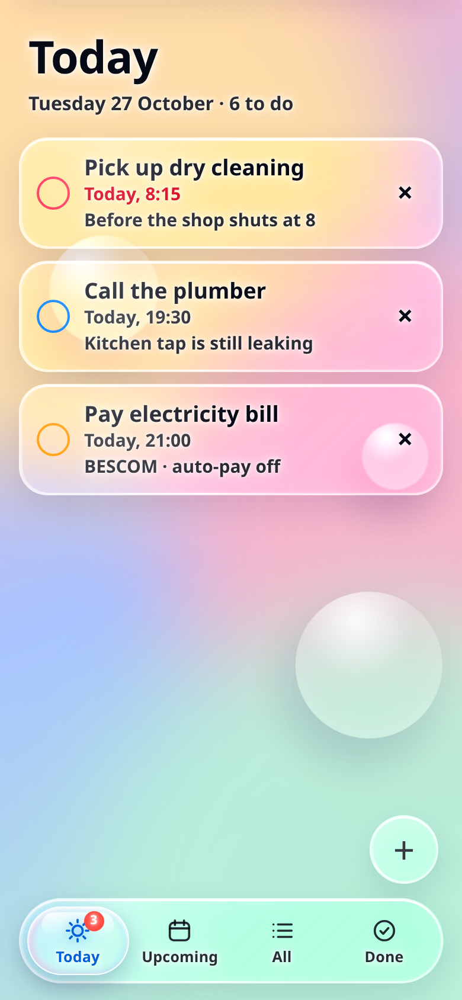
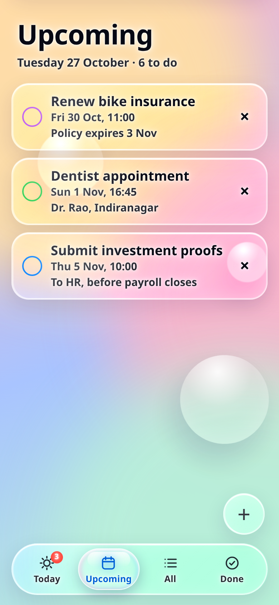
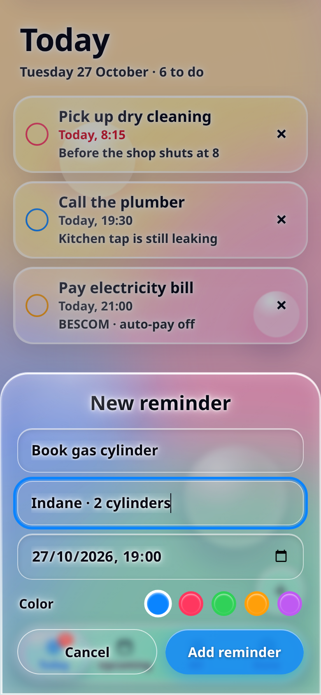
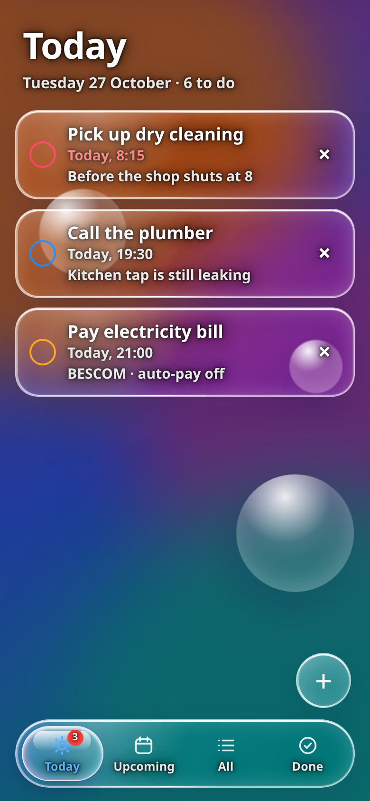
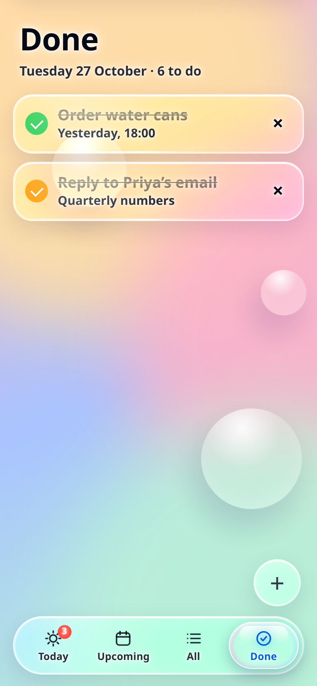
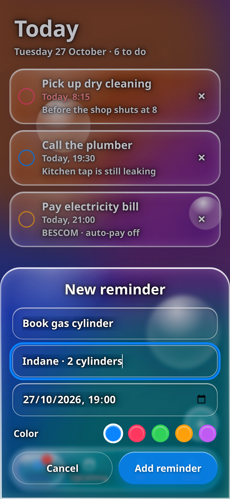

# Reminders

<p align="center">
  <a href="../../releases/latest"></a>
  
  
  
  
</p>

A liquid-glass reminders app for Android. The interface is the HTML/CSS/JS design in
`assets/index.html`; everything underneath it is a native Android shell that turns it into a
real, installable app — system alarms, notification-tray alerts, and persistence across
reboots.

## Screenshots

<p align="center">
  
  
  
</p>
<p align="center">
  
  
  
</p>

Captured from the app itself at 390×844 @2x — the same `assets/index.html` that ships inside the
APK, with sample data. The red timestamp on "Pick up dry cleaning" is the overdue state, and the
"3" badge on the Today tab counts what is still due today.

## Download

Grab `Reminders.apk` from the [latest release](../../releases/latest) and sideload it.
Requires Android 7.0 (API 24) or newer.

## What the native shell adds

The HTML design already worked in a browser. These are the pieces that make it an app:

| Browser limitation | What the app does instead |
| --- | --- |
| `Notification` API does not exist in a WebView | Reminders are registered with `AlarmManager` and fire as real system notifications, even when the app is closed |
| Page must be open to notice a due time | `setExactAndAllowWhileIdle` wakes the device at the due minute |
| Alarms are lost on reboot | `BootReceiver` re-arms every pending reminder on `BOOT_COMPLETED` and after app updates |
| `localStorage` only | Same storage, but the reminder list is mirrored to `SharedPreferences` so the alarm scheduler can read it without the page |
| No safe-area insets in a WebView | `MainActivity` measures the status/navigation/IME insets and feeds them to CSS as `--sat` / `--sab` |

The JS layer talks to native code through a small bridge exposed as `window.AndroidBridge`:

```
BR.schedule(id, title, notes, dueMillis)   // register one alarm
BR.cancel(id)                              // drop one alarm
BR.resync(json)                            // rebuild all alarms from the current list
BR.askNotifications()                      // request POST_NOTIFICATIONS on Android 13+
```

`syncAll()` in the page calls `resync` after every add, toggle or delete, so the native
schedule always mirrors what is on screen.

## Project layout

```
AndroidManifest.xml                     permissions, activity, receivers
assets/index.html                       the entire UI (glass design, pager, sheet)
java/com/liquid/reminders/
    MainActivity.java                   WebView host, insets, back handling, JS bridge
    ReminderScheduler.java              SharedPreferences store + AlarmManager + notifications
    ReminderReceiver.java               fires a notification at the due time
    BootReceiver.java                   re-arms alarms after reboot / update
res/                                    theme, colours, adaptive launcher icon, status icon
build.sh                                aapt2 -> javac -> d8 -> zipalign -> apksigner
```

## Building

The build is plain SDK tooling, no Gradle. You need JDK 17 and Android SDK
build-tools 34 + platform 34:

```bash
export ANDROID_HOME=/path/to/android-sdk
./build.sh          # writes build/Reminders.apk
```

`build.sh` generates a signing keystore on first run if `keys/liquid.keystore` is missing.
Replace it with your own key before publishing anywhere real.

## Notes

- The APK is signed with a self-generated key, so it installs fine by sideload but is not
  on Play Store and will not update over a build signed with a different key.
- `USE_EXACT_ALARM` is declared because this is a reminder app; without it Android 12+
  would refuse exact scheduling.
- Data lives only on the device. Nothing is uploaded and the app requests no internet
  permission.

## Contributing

Issues and pull requests are welcome. The whole app is a few hundred lines — `assets/index.html`
is the interface, and four Java files hold the rest. See [CONTRIBUTING.md](CONTRIBUTING.md) for the
layout and how to build it. Keep the front end a single self-contained file; there is no bundler
and no third-party dependency, and that is deliberate.

## Licence

[MIT](LICENSE) — use it, fork it, ship it, just keep the copyright notice.
