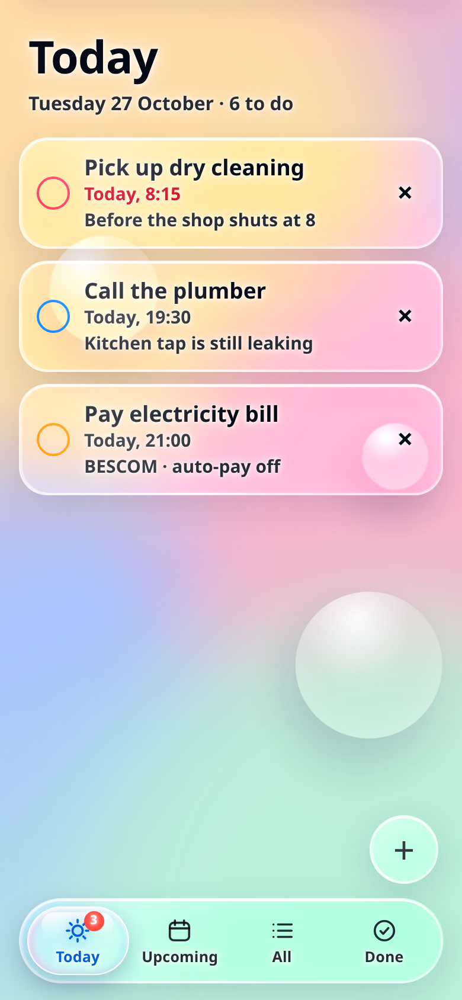
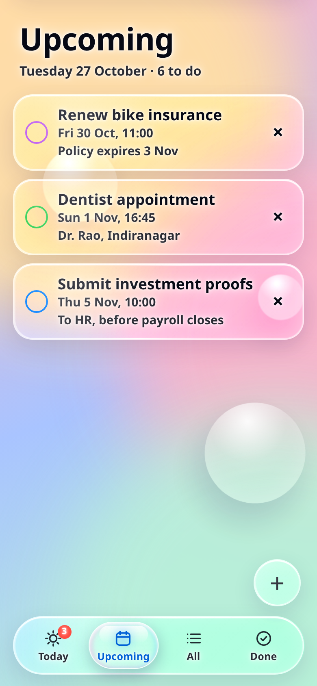
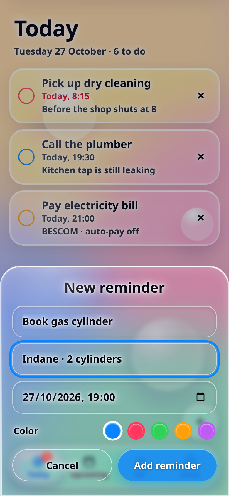
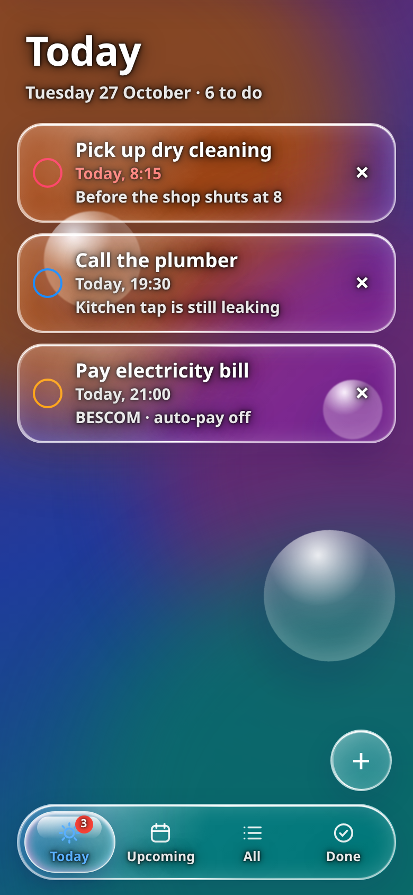
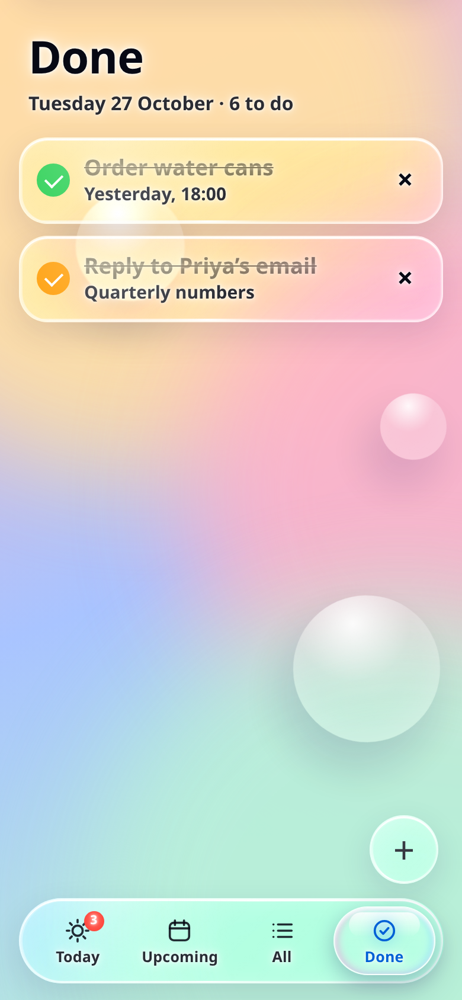
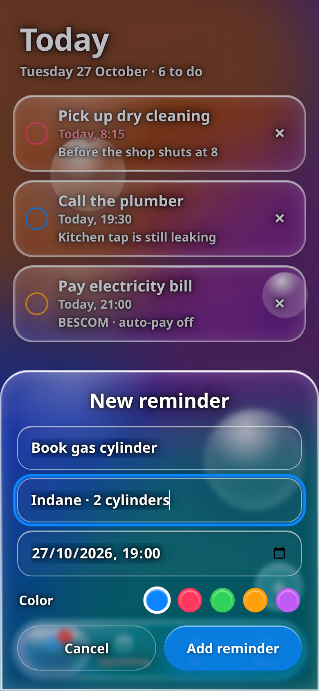
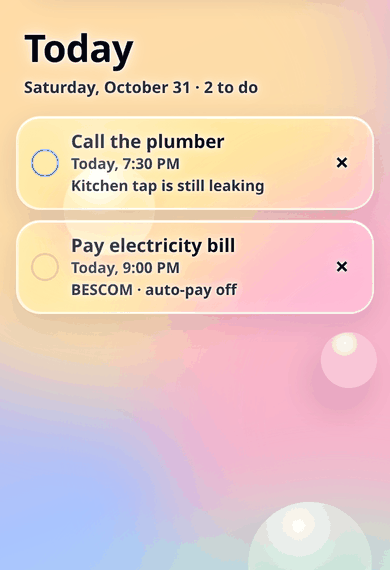
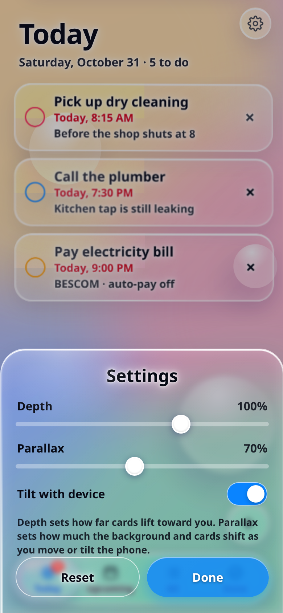
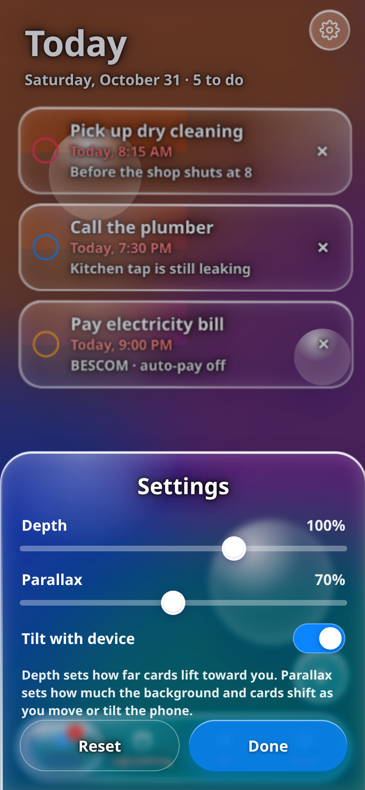

<div align="center">

<a href="https://github.com/technicalnihilist-lgtm/liquid-reminders/stargazers"></a>&nbsp;<a href="https://github.com/technicalnihilist-lgtm/liquid-reminders/network/members"></a>

<h3>Liquid-glass reminders app for Android — HTML UI wrapped in a native shell with real alarms…</h3>

   

<a href="https://github.com/technicalnihilist-lgtm/liquid-reminders/releases/latest"></a>

<b>Support the work</b>

  

<sub>Donations aren't live yet — Paytm, UPI, PayPal and Buy&nbsp;Me&nbsp;a&nbsp;Coffee all show <b>coming soon</b>. Until then, a ⭐ star is the best support.</sub>

<a href="https://github.com/technicalnihilist-lgtm/liquid-reminders/releases/latest"></a>  <a href="https://github.com/technicalnihilist-lgtm/liquid-reminders/releases"></a>

<h4>Get it from</h4>

<a href="https://github.com/technicalnihilist-lgtm/liquid-reminders/releases"></a> <a href="https://github.com/technicalnihilist-lgtm/liquid-reminders/archive/refs/heads/main.zip"></a>

</div>

---

---

## Screenshots

<p align="center">
  
  
  
</p>
<p align="center">
  
  
  
</p>

Captured from the app itself at 390×844 @2x — the same `assets/index.html` that ships inside the
APK, with sample data. The red timestamp on "Pick up dry cleaning" is the overdue state, and the
"3" badge on the Today tab counts what is still due today.

The app reopens on the tab you last settled on — Today, Upcoming, All or Done — instead of
sliding back to Today each launch: that index is stored beside the list and read back once the
pager has a width.

## Motion

<p align="center">
  
</p>

Cards live in a 3D space. Pressing one lifts it toward the viewer, tilts it toward your finger and
deepens its shadow; releasing it runs an overshoot spring that dips past rest before settling. The
same spring drives the rest of the interface:

- **Depth bounce on press** — the card translates 38 px toward the viewer along Z, scales up and
  tilts up to 8° toward wherever you touched, so the lift has a direction.
- **Spring settle on release** — a five-stop keyframe that overshoots, undershoots and settles,
  rather than easing straight back.
- **4D cascade** — when a list is rebuilt, cards fly in from 130 px behind the screen, staggered
  38 ms apart, each landing with a small overshoot.
- **Tab lens** — the glass lens dips into the bar and springs back 1.24x its height each time a
  tab settles.
- **Add button** — pushes away from you on touch-down, then springs past rest on release.
- **Sheet and toast** — arrive from depth with a slight rotateX, so they unfold toward you.

All of it is CSS transforms and one small script — no animation library. Everything is disabled
under `prefers-reduced-motion: reduce`.

## Parallax and settings

<p align="center">
  
  
</p>

The whole scene is parallaxed. The background drifts against the content, each card shifts by a
depth layer (a little more than the one above it), and the list tilts a degree or two in 3D. It is
driven by the device gyroscope where one is available, and by your finger otherwise.

Tap the gear in the header to tune it:

- **Depth** (0-150%) - how far cards lift toward you on press, and how far the cascade falls in from
- **Parallax** (0-150%) - how much the background, cards and tilt move
- **Tilt with device** - gyroscope-driven 3D tilt on or off

Settings live in `localStorage["liquid.settings.v1"]` and survive a restart. Everything still
switches off under `prefers-reduced-motion`.

## Download

Grab `Reminders.apk` from the [latest release](../../releases/latest) and sideload it.
Requires Android 7.0 (API 24) or newer.

## What the native shell adds

The HTML design already worked in a browser. These are the pieces that make it an app:

| Browser limitation | What the app does instead |
| --- | --- |
| `Notification` API does not exist in a WebView | Reminders are registered with `AlarmManager` and fire as real system notifications, even when the app is closed |
| Page must be open to notice a due time | `setExactAndAllowWhileIdle` wakes the device at the due minute |
| Alarms are lost on reboot | `BootReceiver` re-arms every pending reminder on `BOOT_COMPLETED` and after app updates |
| `localStorage` only | Same storage, but the reminder list is mirrored to `SharedPreferences` so the alarm scheduler can read it without the page |
| No safe-area insets in a WebView | `MainActivity` measures the status/navigation/IME insets and feeds them to CSS as `--sat` / `--sab` |
| A refused notification makes a due reminder look forgotten | Once the permission answer is known the shell tells the page, which says so in its own toast — once per install |
| `navigator.vibrate` is refused until the page has been tapped | The page asks the shell for the buzz instead, so a reminder coming due with the app open but untouched still buzzes |
| A notification outlives the reminder it announced | `notify()` keeps the ids it has posted, and `resync()` takes the tray copy down once the reminder is ticked off or deleted |

The JS layer talks to native code through a small bridge exposed as `window.AndroidBridge`:

```
BR.schedule(id, title, notes, dueMillis)   // register one alarm
BR.cancel(id)                              // drop one alarm
BR.resync(json)                            // rebuild all alarms from the current list
BR.askNotifications()                      // request POST_NOTIFICATIONS on Android 13+
BR.buzz()                                  // the alert's buzz, for a reminder coming due
BR.now()                                   // the device clock, in milliseconds
```

`syncAll()` in the page calls `resync` after every add, toggle or delete, so the native
schedule always mirrors what is on screen. The shell keeps a signature of the last list it
synced and skips the rebuild when a new one is identical, so opening the app costs no alarm
work. Only `resync`, `askNotifications` and `buzz` are called today; `schedule` and `cancel` stay
part of the interface but the page hands over the whole list instead.

## Project layout

```
AndroidManifest.xml                     permissions, activity, receivers
assets/index.html                       the entire UI (glass design, pager, sheet)
java/com/liquid/reminders/
    MainActivity.java                   WebView host, insets, back handling, JS bridge
    ReminderScheduler.java              SharedPreferences store + AlarmManager + notifications
    ReminderReceiver.java               fires a notification at the due time
    BootReceiver.java                   re-arms alarms after reboot / update
res/                                    theme, colours, adaptive launcher icon, status icon
build.sh                                aapt2 -> javac -> d8 -> zipalign -> apksigner
```

## Building

The build is plain SDK tooling, no Gradle. You need JDK 17 and Android SDK
build-tools 34 + platform 34:

```bash
export ANDROID_HOME=/path/to/android-sdk
./build.sh          # writes build/Reminders.apk
```

`build.sh` generates a signing keystore on first run if `keys/liquid.keystore` is missing.
Replace it with your own key before publishing anywhere real.

## Notes

- The APK is signed with a self-generated key, so it installs fine by sideload but is not
  on Play Store and will not update over a build signed with a different key.
- `USE_EXACT_ALARM` is declared because this is a reminder app; without it Android 12+
  would refuse exact scheduling.
- Data lives only on the device. Nothing is uploaded and the app requests no internet
  permission.

## Contributing

Issues and pull requests are welcome. The whole app is a few hundred lines — `assets/index.html`
is the interface, and four Java files hold the rest. See [CONTRIBUTING.md](CONTRIBUTING.md) for the
layout and how to build it. Keep the front end a single self-contained file; there is no bundler
and no third-party dependency, and that is deliberate.

## Licence

[MIT](LICENSE) — use it, fork it, ship it, just keep the copyright notice.

---

---

## 🌍 Languages

<sub>Donations are <b>coming soon</b> in every language below — nothing to pay today, nothing to click.</sub>

<div align="center">

<sub><b>हिन्दी · বাংলা · मराठी · తెలుగు · தமிழ் · ગુજરાતી · ಕನ್ನಡ · മലയാളം · ਪੰਜਾਬੀ · ଓଡ଼ିଆ · অসমীয়া · اردو</b></sub>

</div>

<details>
<summary><b>🌍 Open the same message in 53 languages</b></summary>

**🇮🇳 Indian languages**

- **हिन्दी** (Hindi) — ☕ जल्द ही आ रहा है। · ⭐ अगर आपको यह ऐप और हमारा काम पसंद है, तो कृपया रिपॉजिटरी को स्टार दें और हमें फॉलो करें।
- **বাংলা** (Bengali) — ☕ খুব শিগগিরই আসছে। · ⭐ যদি আপনার এই অ্যাপ এবং আমাদের কাজ ভালো লাগে, তবে অনুগ্রহ করে রিপোজিটরিটিকে একটি স্টার দিন এবং আমাদের ফলো করুন।
- **मराठी** (Marathi) — ☕ लवकरच येत आहे. · ⭐ जर तुम्हाला हे ॲप आणि आमचं काम आवडलं असेल, तर कृपया रिपॉझिटरीला स्टार द्या आणि आम्हाला फॉलो करा.
- **తెలుగు** (Telugu) — ☕ త్వరలో రాబోతోంది. · ⭐ మీకు ఈ యాప్, మా పని నచ్చితే, దయచేసి రిపోజిటరీకి ఒక స్టార్ ఇచ్చి మమ్మల్ని ఫాలో అవ్వండి.
- **தமிழ்** (Tamil) — ☕ விரைவில் வருகிறது. · ⭐ உங்களுக்கு இந்த ஆப்பும் எங்க வேலையும் பிடிச்சிருந்தா, தயவுசெஞ்சு இந்த ரெபாசிட்டரிக்கு ஒரு ஸ்டார்…
- **ગુજરાતી** (Gujarati) — ☕ ટૂંક સમયમાં આવી રહ્યું છે. · ⭐ જો તમને આ એપ અને અમારું કામ ગમતું હોય, તો પ્લીઝ રિપોઝિટરીને સ્ટાર આપો અને અમને ફોલો કરો.
- **ಕನ್ನಡ** (Kannada) — ☕ ಶೀಘ್ರದಲ್ಲೇ ಬರುತ್ತಿದೆ. · ⭐ ನಿಮಗೆ ಈ ಆ್ಯಪ್ ಮತ್ತು ನಮ್ಮ ಕೆಲಸ ಇಷ್ಟವಾದರೆ, ದಯವಿಟ್ಟು ರೆಪೊಸಿಟರಿಗೆ ಸ್ಟಾರ್ ಕೊಡಿ ಮತ್ತು ನಮ್ಮನ್ನು ಫಾಲೋ ಮಾಡಿ.
- **മലയാളം** (Malayalam) — ☕ ഉടൻ വരുന്നു. · ⭐ നിങ്ങൾക്ക് ഈ ആപ്പും ഞങ്ങളുടെ പ്രവർത്തനവും ഇഷ്ടപ്പെട്ടെങ്കിൽ, ദയവായി റെപ്പോസിറ്ററിക്ക് ഒരു സ്റ്റാർ…
- **ਪੰਜਾਬੀ** (Punjabi) — ☕ ਜਲਦੀ ਆ ਰਿਹਾ ਹੈ। · ⭐ ਜੇ ਤੁਹਾਨੂੰ ਇਹ ਐਪ ਅਤੇ ਸਾਡਾ ਕੰਮ ਪਸੰਦ ਹੈ, ਤਾਂ ਕਿਰਪਾ ਕਰਕੇ ਰਿਪੋਜ਼ਟਰੀ ਨੂੰ ਸਟਾਰ ਦਿਓ ਅਤੇ ਸਾਨੂੰ ਫਾਲੋ ਕਰੋ।
- **ଓଡ଼ିଆ** (Odia) — ☕ ଖୁବ୍ ଶୀଘ୍ର ଆସୁଛି। · ⭐ ଯଦି ଆପଣଙ୍କୁ ଏହି ଆପ୍ ଏବଂ ଆମର କାମ ଭଲ ଲାଗୁଛି, ତେବେ ଦୟାକରି ରିପୋଜିଟୋରୀକୁ ଗୋଟିଏ ଷ୍ଟାର୍ ଦିଅନ୍ତୁ ଏବଂ ଆମକୁ ଫଲୋ କରନ୍ତୁ।
- **অসমীয়া** (Assamese) — ☕ অতি সোনকালেই আহি আছে। · ⭐ যদি আপুনি এই এপটো আৰু আমাৰ কাম ভাল পায়, তেন্তে অনুগ্ৰহ কৰি ৰিপজিটৰীটোক এটা ষ্টাৰ দিয়ক আৰু আমাক ফ'ল' কৰক।
- **اردو** (Urdu) — ☕ جلد آرہا ہے۔ · ⭐ اگر آپ کو یہ ایپ اور ہمارا کام پسند آئے تو براہ کرم ریپازٹری کو سٹار دیں اور ہمیں فالو کریں۔
- **संस्कृतम्** (Sanskrit) — ☕ शीघ्रमेव आगच्छति।
- **मैथिली** (Maithili) — ☕ जल्दिये आबि रहल अछि।
- **कोंकणी** (Konkani) — ☕ रोखडेंच येता.
- **کٲشُر** (Kashmiri) — ☕ جَلدی یِوان چھُ۔
- **سنڌي** (Sindhi) — ☕ जल्द अची रह्यो आहे।
- **डोगरी** (Dogri) — ☕ जल्दी आ करदा ऐ।
- **ꯃꯤꯇꯩ ꯂꯣꯟ** (Manipuri) — ☕ ꯑꯊꯨꯕꯥ ꯃꯇꯝꯗꯥ ꯂꯥꯛꯀꯅꯤ꯫
- **बर’** (Bodo) — ☕ थाबैनो फैगोन।
- **ᱥᱟᱱᱛᱟᱲᱤ** (Santali) — ☕ ᱞᱚᱜᱚᱱ ᱦᱤᱡᱩᱜ ᱠᱟᱱᱟ᱾
- **नेपाली** (Nepali) — ☕ छिट्टै आउँदैछ। · ⭐ यदि तपाईंलाई यो एप र हाम्रो काम मन पर्‍यो भने, कृपया रिपोजिटरीलाई स्टार दिनुहोस् र हामीलाई फलो गर्नुहोस्।

**🌍 World languages**

- **العربية** (Arabic) — ☕ قريبًا. · ⭐ إذا أعجبك هذا التطبيق وعملنا، فيرجى منح المستودع نجمة ومتابعتنا.
- **简体中文** (Chinese (Simplified)) — ☕ 即将推出。
- **繁體中文** (Chinese (Traditional)) — ☕ 即將推出。
- **Čeština** (Czech) — ☕ Již brzy.
- **Dansk** (Danish) — ☕ Kommer snart.
- **Nederlands** (Dutch) — ☕ Binnenkort beschikbaar. · ⭐ Vind je deze app en ons werk leuk?
- **Filipino** (Filipino) — ☕ Malapit na.
- **Suomi** (Finnish) — ☕ Tulossa pian.
- **Français** (French) — ☕ Bientôt disponible. · ⭐ Si cette application et notre travail vous plaisent, mettez une étoile au dépôt et suivez-nous.
- **Deutsch** (German) — ☕ Bald verfügbar. · ⭐ Wenn dir diese App und unsere Arbeit gefallen, gib dem Repository einen Stern und folge uns.
- **Ελληνικά** (Greek) — ☕ Έρχεται σύντομα.
- **עברית** (Hebrew) — ☕ בקרוב.
- **Magyar** (Hungarian) — ☕ Hamarosan.
- **Bahasa Indonesia** (Indonesian) — ☕ Segera hadir. · ⭐ Jika kamu suka aplikasi ini dan karya kami, beri bintang pada repositori ini dan ikuti kami.
- **Italiano** (Italian) — ☕ In arrivo.
- **日本語** (Japanese) — ☕ 近日公開。 · ⭐ このアプリと私たちの仕事が気に入ったら、リポジトリにスターを付けてフォローしてください。
- **한국어** (Korean) — ☕ 곧 공개됩니다. · ⭐ 이 앱과 저희 작업이 마음에 드신다면 저장소에 스타를 눌러 주시고 팔로우해 주세요.
- **Bahasa Melayu** (Malay) — ☕ Akan datang.
- **Norsk** (Norwegian) — ☕ Kommer snart.
- **فارسی** (Persian) — ☕ به‌زودی.
- **Polski** (Polish) — ☕ Wkrótce. · ⭐ Jeśli podoba Ci się ta aplikacja i nasza praca, daj repozytorium gwiazdkę i obserwuj nas.
- **Português** (Portuguese) — ☕ Em breve.
- **Română** (Romanian) — ☕ În curând.
- **Русский** (Russian) — ☕ Скоро. · ⭐ Если вам нравится это приложение и наша работа, поставьте звёздочку репозиторию и подпишитесь на нас.
- **Español** (Spanish) — ☕ Muy pronto. · ⭐ Si te gusta esta app y nuestro trabajo, dale una estrella al repositorio y síguenos.
- **Kiswahili** (Swahili) — ☕ Inakuja hivi karibuni.
- **Svenska** (Swedish) — ☕ Kommer snart.
- **ไทย** (Thai) — ☕ เร็ว ๆ นี้
- **Türkçe** (Turkish) — ☕ Çok yakında.
- **Українська** (Ukrainian) — ☕ Незабаром.
- **Tiếng Việt** (Vietnamese) — ☕ Sắp ra mắt. · ⭐ Nếu bạn thích ứng dụng này và công việc của chúng tôi, hãy tặng kho lưu trữ một ngôi sao và theo…

</details>

